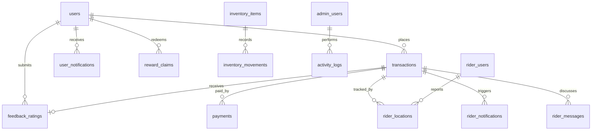

# HydroMIS Database Schema

This document describes the MySQL database used by HydroMIS. The canonical base DDL is in [`database/schema.sql`](../database/schema.sql). Some modules also create or extend tables at runtime; those module-managed tables are listed here so the documentation matches the running application.

## Overview

The database stores customer accounts, water orders, payments, staff and rider accounts, delivery tracking, inventory, rewards, feedback, notifications, and configurable system settings. IDs such as `user_id`, `transaction_id`, and `rider_id` are application-level identifiers used across modules. Several relationships are enforced with foreign keys; other relationships are logical and are joined by these identifier columns.

## Core tables

| Table | Purpose | Primary key / important relationships |
|---|---|---|
| `users` | Customer accounts, approval state, contact details, QR path, and loyalty balance. | `id`; unique `user_id` and `email`. `transactions.user_id`, `feedback_ratings.user_id`, and notification/reward rows refer to `user_id`. |
| `transactions` | Water orders and transaction lifecycle, including pricing, discounts, payment data, fulfillment, rider assignment, and approval. | `id`; unique `transaction_id`; `user_id` references `users.user_id`. |
| `admin_users` | Admin and staff login accounts and roles. | `id`; unique `admin_id` and `username`. |
| `activity_logs` | Legacy admin action log. | `id`; `admin_id` is a logical reference to `admin_users.admin_id`. |
| `rider_users` | Rider login and profile records. | `id`; unique `rider_id` and `username`. |
| `payments` | Payment records associated with orders, including method, reference, proof path, and status. | `id`; unique `payment_id`; `transaction_id` and `user_id` are logical references. |
| `feedback_ratings` | Customer rating and optional feedback for an order. | `id`; unique `(transaction_id, user_id)`; both columns have foreign keys to their respective unique identifiers. |
| `reward_claims` | Customer reward redemption history and claim status. | `id`; unique `transaction_id`; `user_id` is a logical reference. |
| `inventory_items` | Container stock and minimum-stock thresholds. | `id`; unique `item_code`. |
| `inventory_movements` | Stock adjustment history with before/after quantities and staff attribution. | `id`; `item_id` logically references `inventory_items.id`. |
| `user_notifications` | In-app customer notifications and read state. | `id`; `user_id` and optional `transaction_id` are logical references. |

### Transactions

`transactions` is the central order record. Its columns include:

- Order identity and customer: `transaction_id`, `user_id`.
- Price breakdown: `amount`, `price_per_unit`, `quantity`, `discount`, `water_type`, `container_size`, and `container_status`.
- Payment: `payment_method`, `payment_reference`, `payment_status`, `payment_date`, `payment_proof`, `amount_tendered`, and `change`.
- Fulfillment: `fulfillment_method`, `delivery_status`, `rider_id`, `assigned_rider`, `qr_priority`, and inventory reservation fields.
- Review and audit: `status`, `approved_by`, `cancellation_reason`, `notes`, and timestamps.

### Delivery tables

| Table | Purpose | Key fields |
|---|---|---|
| `rider_locations` | Latest/repeated rider coordinates for an order. | `transaction_id`, `rider_id`, latitude/longitude, accuracy, speed, heading, timestamps; indexes support order, rider, and recency lookups. |
| `rider_notifications` | Notifications delivered to riders for assigned work. | `rider_id`, `transaction_id`, title/message, `is_read`. |
| `rider_messages` | Messages exchanged between participants about an order. | `transaction_id`, sender, recipient, message. |

The rider and order references in these tables are logical references; the base schema does not declare foreign keys for them.

## Runtime-managed tables

These tables are initialized by application modules rather than the base `database/schema.sql` file:

| Table | Purpose | Defined/managed by |
|---|---|---|
| `system_settings` | Key/value configuration, including pricing rules, logo path, loyalty options, and reward availability markers. | `config/system_settings.php`; pricing UI in `admin/pricing.php`. |
| `custom_rewards` | Admin-defined reward catalog entries. | `config/reward_catalog.php`. Built-in rewards are defined in PHP. |
| `admin_settings` | Per-admin JSON preferences. | `admin/dashboard.php`. |
| `admin_profiles` | Extended admin contact/profile data. | `admin/dashboard.php`. |
| `system_activity_logs` | Detailed application activity log including actor, page, request metadata, and JSON-like metadata text. | `config/activity_logger.php`. This supplements the older `activity_logs` table. |
| `payment_qr_settings` | Payment QR configuration where enabled by the database setup routines. | `config/database.php`. |

Several existing installations may have additional columns added by runtime migrations. Examples include `admin_users.source_user_id`, `admin_users.login_enabled`, `admin_users.profile_image`, `rider_users.source_user_id`, `rider_users.login_enabled`, and `reward_claims.customer_seen_at`. Use the current application setup/migration code when upgrading an older database.

## Relationship and integrity notes

- `users.user_id` and `transactions.transaction_id` are unique business identifiers. Code commonly uses them for joins instead of the numeric `id` columns.
- The base schema enforces `transactions.user_id → users.user_id`, and `feedback_ratings` references both the related transaction and customer.
- Many other cross-module identifiers are intentionally not foreign-key constrained. The application must keep those references consistent when deleting or changing accounts/orders.
- Payment information appears both on `transactions` and in the separate `payments` table. The transaction fields are used by checkout and staff payment workflows; `payments` stores payment records/history.
- Uploaded images, QR codes, and payment proofs are stored as paths in the database; the file contents live in the application's storage directories.

## Setup and maintenance

1. Create/select the HydroMIS database and configure credentials in `config/database.local.php` (use the example file as a template).
2. Import [`database/schema.sql`](../database/schema.sql) for the base tables.
3. Run the normal HydroMIS setup/initialization flow so runtime-managed tables and compatibility columns are created.
4. Back up both the database and referenced uploaded files before upgrades or production changes.

The SQL schema currently includes sample account and transaction rows for local/demo use. Review those seed statements before importing into a production database.
