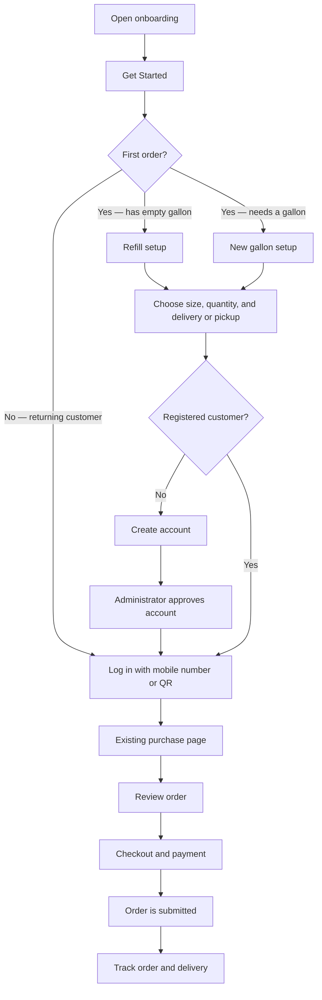
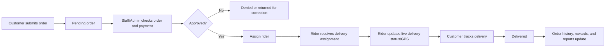

# HydroMIS System Process Manual

This guide explains the end-to-end flow for customers, administrators, staff, and riders.

## 1. Customer order journey

### First-time customer

1. Open `onboarding.php` and select **Get Started**.
2. Select one setup option:
   - **Yes, I have a gallon** opens `refill_order.php`. The customer returns an empty container and pays for the refill.
   - **No, I need a new gallon** opens `new_gallon_order.php`. The customer orders a new container with the first refill.
3. Select gallon size, quantity, and delivery or station pickup.
4. Select **Create account to continue**.
5. Register with name, address, and mobile number.
6. The administrator approves the account.
7. The customer logs in by mobile number or QR code.
8. HydroMIS opens the existing purchase flow with the selected size, quantity, container status, and fulfillment option already prepared.
9. The customer reviews the order, completes checkout/payment, and tracks the delivery.

### Returning customer

1. Select **Log in with mobile number or QR**.
2. Log in using the registered mobile number or personal QR code.
3. Open the purchase page to make a new order, or use order history to view a previous order.
4. Review the order, check out, and track the delivery.

> Current rule: the live system allows one active order per customer. A customer must wait for the current order to be delivered or resolved before placing another one.

## 2. Order processing workflow

## 3. Role responsibilities

| Role | Main work | Main pages |
|---|---|---|
| Customer | Register, log in, order, pay, track, view history/rewards | `onboarding.php`, `home.php`, `user/` |
| Administrator | Approve customers, manage orders/payments, riders, reports, and inventory settings | `admin/` |
| Staff | Review pending orders, process payments, manage delivery operations and rewards | `staff/` |
| Rider | View assigned deliveries and update delivery/GPS status | `rider/` |

## 4. How the new setup screens connect to the existing system

| Setup screen | Data passed to purchase flow | Existing next step |
|---|---|---|
| `refill_order.php` | size, quantity, `existing` container, delivery/pickup | `user/purchase.php` → review → checkout |
| `new_gallon_order.php` | size, quantity, `new` container, delivery/pickup | `user/purchase.php` → review → checkout |

## 5. Recommended future cart flow

For a full multi-item **Add to Cart** experience, HydroMIS should add a cart and order-items structure first. The recommended flow is:

`Choose products → Add to cart → Continue shopping → Review cart → Select delivery → Payment → One checkout → One delivery tracking record`

Until that database change is implemented, keep the current single active-order flow. It avoids incorrect totals, lost items, and conflicting delivery requests.
